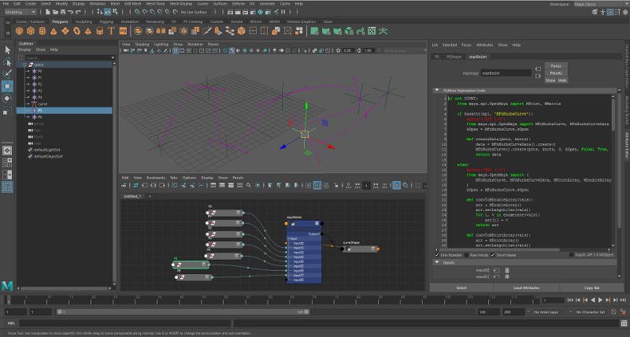
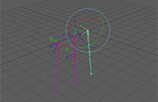
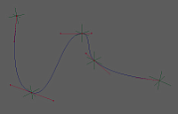
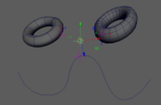
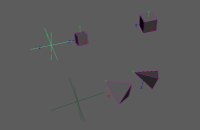
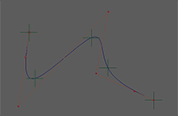
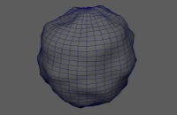
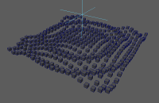
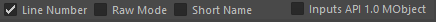
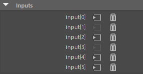

# maya_exprespy

English | [日本語](README.ja.md)

A node plugin that provides Python expression functionality in Maya.
It is called "exprespy".




## Features
This plugin is implemented as a C++ node with a focus on execution speed.
As a result, Python expression code is kept compiled in memory and executed efficiently.

Furthermore, in the editor (Attribute Editor), you can write code using actual node and attribute names, just like the native Expression Editor.
These names are automatically replaced with actual node connections, similar to the native functionality.
However, unlike native expressions, it does not perform unit conversion and always handles values in internal units.
This is the only part that might be slightly tricky for beginners, but it is the reason for its high efficiency.

In addition, it supports Python API 2.0 types, allowing you to directly input and output any data types—not only double3 and matrix attributes but also geometry data.

It supports both Python 2.x and Python 3.x depending on the Maya version.

Please read the [Limitations](#limitation) section before use.


## Similar Technologies
The bundled MASH feature includes a Python node that allows you to control motion graphics using Python.
However, that is a mechanism designed to control particle data, and while its specialized performance is excellent, it is not general-purpose.

Additionally, a well-known plugin that allows writing regular expressions in Python is the [pyExpression](http://www.soup-dev.com/wiki/PyExpression.html) node included in [SOuP](http://www.soup-dev.com/).
However, it is entirely implemented in Python, and its Python expression code is executed using the `exec()` function, which compiles the code every time it runs and is therefore inefficient.
I was drawn to the aspirations of that plugin, and created exprespy to make something even better.


## Directory Structure
* [examples](examples): Example Maya scenes.
* [plug-ins](plug-ins): Prebuilt plugin binaries.
* [python](python): Supporting Python modules.
* [scripts](scripts): Supporting MEL scripts.
* [srcs](srcs): C++ source code.
* [viewTemplates](viewTemplates): Templates for the Node Editor.


## Installation Method
* Copy the files inside the folder for your platform and version under the "plug-ins" directory to a folder included in your `MAYA_PLUG_IN_PATH`.
  `Documents\maya\(version)\plug-ins` is also fine.

  For Maya 2022 and later, folder names containing "py2" are for Python 2, and those without are for Python 3.

* Copy the files in the "python" folder to a folder included in your `PYTHONPATH`.
  `Documents\maya\scripts` is also fine.

* Copy the files in the "scripts" folder to a folder included in your `MAYA_SCRIPT_PATH`.
  `Documents\maya\scripts` is also fine.

* Copy the files in the "viewTemplates" folder to a folder included in your `MAYA_CUSTOM_TEMPLATE_PATH`.
  If not configured, `Documents\maya\(version)\prefs\viewTemplates` is fine.


## Sample Scenes
* [bend_roll.ma](examples/bend_roll.ma)

  

  An example replacing the [rotationDriver](https://github.com/ryusas/maya_rotationDriver) sample with expressions.

  It shows that expressions are fully capable of handling node implementations of this level.

  To fully benefit from Maya's Parallel Evaluation mode, it is ideal to implement nodes in C++. However, in most cases where you might implement a node plugin in Python, exprespy is more than sufficient.

* [bezierCurve.ma](examples/bezierCurve.ma)

  

  An example of automatically controlling Bézier curve tangents. Useful for curve rig controls.

  This also serves as an example of outputting shape data from an expression.

  Moving the locators corresponding to each CV adjusts the tangents automatically to keep the curve smooth.
  You can also rotate or scale the locators to further manipulate the automatically controlled tangents.
  Turning ON the `closed` attribute added to the bezierCurve shape node closes the curve.
  It tracks the addition and removal of input points in real-time. You can delete inputs using the GUI within the "Inputs" frame of the Attribute Editor, or add/disconnect connections in the Node Editor.

  Since exprespy can automatically detect object outputs from Python API 1.0 and 2.0, this example implements a setup that uses 2.0 if the Maya version supports nurbsCurve control in 2.0, and 1.0 otherwise. It runs on all versions since Maya 2012.
  Both implementations are coded and separated with an `if` statement. You can see how 2.0 is written much more cleanly and executes faster compared to 1.0.

* [closestPoints.ma](examples/closestPoints.ma)

  

  An example that calculates the closest point on the surface of a mesh, nurbsSurface, and nurbsCurve relative to an input locator, and constrains the positions of three corresponding locators.
  For mesh and nurbsSurface, it also retrieves surface normals and tangents to constrain the orientations of the locators.

  This also demonstrates inputting shape data into an expression.

  In Python API 2.0, many features for processing shape data were introduced in Maya 2016. This example is implemented in 1.0 so that it runs on older versions as well.
  To input shape data for 1.0, the `Inputs API 1.0 MObject` option is turned ON on individual exprespy nodes.

* [closestPoints2016.ma](examples/closestPoints2016.ma)

  

  An optimized version of [closestPoints.ma](examples/closestPoints.ma) for Maya 2016 and later.
  It uses Python API 2.0 to process the input shape data.
  Compared to 1.0, the code is very clean and runs faster.
  However, because queries in world space did not work properly (perhaps an issue with API 2.0), a `transformGeometry` node is inserted into the input.

  While operations that process and output all vertices—such as [noiseDeformer.ma](examples/noiseDeformer.ma)—can be demanding for Python expressions, Python expressions are highly effective for referencing input shapes to perform operations as demonstrated here.

* [constraints.ma](examples/constraints.ma)

  

  A simple example implementing various constraint functions via expressions. Highly recommended to look at first.

  It implements position, orient, aim without an up-object, and aim with an up-object.

* [epcurve.ma](examples/epcurve.ma)

  

  Generates a smooth curve by providing control points via locators. While visually similar to [bezierCurve.ma](examples/bezierCurve.ma), this curve is controlled by dynamically performing the equivalent of drawing a curve with the EP Curve Tool.

  Since it simply calls API functions, the code is relatively short.

  However, with this method, you cannot manually control the tangents, and local modifications propagate across the entire curve. For actual rigs, the Bézier curve approach is more practical.

* [noiseDeformer.ma](examples/noiseDeformer.ma)

  

  An implementation example of a simple noise deformer.
  Since `time` is input, it animates.
  Several noise control attributes are added to the mesh's transform node.

  This also serves as an example of inputting and then outputting shape data in expressions.

  The mesh processing here is supported since the initial version of Python API 2.0, so it is fully implemented in 2.0, resulting in clean code. However, the code is long because the noise function itself is also written inside the expression.
  Even with this level of vertex count, it is relatively heavy, showing that processing a large number of vertices in real-time is difficult even with Python API 2.0.
  For mesh deformation tasks, specialized tools like taikomatsu's [SeExprMesh](https://github.com/taikomatsu/SeExprMeshMaya) are better suited.

* [ripple.ma](examples/ripple.ma)

  

  A recreation of [SOuP](http://www.soup-dev.com/)'s pyExpression sample for performance comparison.
  Comparing only the node processing speed with `dgtimer`, it is about 15 times faster.
  In terms of framerate comparison, the difference is not as extreme due to drawing overhead, and it varies by environment, but it was about 3.5 times faster in my environment.

  This is also a simple example showing how to write code using `IN` and `OUT` instead of attribute names.


## Usage
To write expressions, first create an exprespy node. You can use the following methods:

* Load the plugin, and then run the following MEL code (or create the node in the Node Editor, etc.):

  ``` py
  createNode exprespy;
  ```

* Or run the following Python code (it works even if the plugin is not loaded yet):

  ``` py
  import exprespy
  exprespy.create()
  ```

After that, enter your code into the Attribute Editor of the created exprespy node.

The usage is mostly the same as native expressions: any `nodeName.attributeName` written in the code is automatically replaced with actual inputs and outputs (the left side of a `=` assignment is identified as an output, and everything else as an input).

The editor uses the same controls as Maya's native Script Editor (it falls back to a simple text editor in environments where PySide/PyQt is unavailable; PySide is included by default in 2014 and later).
All shortcut keys are the same.
The setting for whether pressing Tab inputs a tab character or spaces is also inherited.

Below the editor, there are checkboxes like the ones shown below.
You can adjust the size of the editor by dragging the border line.



- Line Number: UI setting to show/hide line numbers in the editor.
- Raw Mode: UI setting to toggle Raw Mode ON/OFF.
  For details, see [How Code is Saved and How to Utilize IN and OUT](#rawmode) in the Detailed Specifications section.
- Short Name: UI setting to toggle whether attribute names are displayed as short names.
- Inputs API 1.0 MObject: Switches the inputs of data types like shapes on the exprespy node to API 1.0.
  This is the only setting that is per-node (stored as an attribute on the node).
  For details, see [Input Attribute Types](#input) in the Detailed Specifications section.

Further down is a UI for directly managing input elements.



Normally you do not need to use this, but for details, see [How Code is Saved and How to Utilize IN and OUT](#rawmode) in the Detailed Specifications section.


## Detailed Specifications

* Handling in Internal Units

  Attributes with units are handled in internal units for both inputs and outputs.
  - time is in seconds
  - doubleLinear (distance) is in centimeters
  - doubleAngle is in radians


* Inputs, Outputs, and Dependencies

  Attributes referenced as inputs are connected to the `input[]` attribute of the `exprespy` node, and attributes referenced as outputs (assigned with `=`) are connected to the `output[]` attribute.
  Their types are generic, allowing any connections without inserting `unitConversion` nodes, ensuring efficient performance.

  All outputs depend on all inputs. Logical dependencies within the code do not separate them.
  Therefore, it is bad practice to write all the logic of your scene into a single `exprespy` node.
  This concept and mechanism is exactly the same as the native `expression` node.


* <a name="input"> Input Attribute Types

  In Python, input attribute types are mapped as follows:

  | Maya Attribute Type | Python Type |
  |--:|:--|
  | bool | int (Note 1) |
  | Integer types (short, long, enum, etc.) | int |
  | Real number types (double, float, etc.) | int or float (Note 2) |
  | Real number types with units (time, distance, angle) | int or float (Note 2) |
  | string | unicode (str from py3 onward) |
  | matrix | API 2.0 MMatrix (Note 3) |
  | double3 | API 2.0 MVector (Note 3)(Note 4) |
  | Numeric compound types other than double3 | list of int or float (Note 3)(Note 4) |
  | Other types (shape data, etc.) | API 2.0 MObject (can switch to API 1.0) (Note 5) |
  | null or error state | None |

  - (Note 1): Since type identification is unavailable for numeric attribute inputs, unfortunately, `bool` is converted to `int`.
  - (Note 2): Since type identification is unavailable for numeric attribute inputs, they default to `float`, but become `int` if they can be represented as an integer.
  - (Note 3): It is perfectly safe to modify input `MMatrix`, `MVector`, or `list` variables within the expression.
  - (Note 4): Among all numeric compound types, only `double3` is mapped to `MVector` for convenience and historical reasons. If you need an `MPoint` or `MEulerRotation`, please convert them. Other compound types are mapped to `list`, so convert them as needed (e.g., `double4` does not automatically become an `MQuaternion`).
  - (Note 5): Turning ON the `Inputs API 1.0 MObject` (`inputsAPI1` attribute) on individual `exprespy` nodes switches only `MObject` inputs to API 1.0.


* <a name="output"> Output Attribute Types

  In Maya, Python outputs are mapped to attribute types as follows:

  | Python Type | Maya Attribute Type |
  |--:|:--|
  | bool | bool (Note 1) |
  | int | long (Note 1) |
  | long (py2 only) | long (Note 1) |
  | float | double (Note 1)(Note 2) |
  | str (bytes from py3 onward) | string |
  | unicode (str from py3 onward) | string |
  | API 2.0 MMatrix | matrix |
  | API 2.0 MVector | double3 (Note 2) |
  | API 2.0 MPoint | double3 (Note 2) |
  | API 2.0 MEulerRotation | double3 (Note 2) |
  | API 2.0 MQuaternion | double4 (Note 2) |
  | API 2.0 MColor | float3 |
  | API 2.0 MFloatVector | float3 |
  | API 2.0 MFloatPoint | float3 |
  | sequence (list, tuple, etc.) | Appropriate numeric compound type (Note 2)(Note 3) |
  | API 2.0 MObject | Keeps as data type |
  | API 1.0 MObject | Keeps as data type |
  | Other unrecognized types | Ignored |

  - (Note 1): Any scalar numeric types (including numeric types with units) can be connected even if types do not match exactly.
  - (Note 2): Numeric types with units (time, distance, angle) can also be connected without inserting a `unitConversion` node.
  - (Note 3): Supported numeric compounds include `short2`, `short3`, `long2`, `long3`, `double2`, `double3`, `double4`, `float2`, and `float3`, all of which can be connected. If the Python sequence length exceeds 4, it is truncated to 4.


* Scope

  Each Python expression code runs in its own independent global scope (in version 1.0, accessing names in Maya's Python global scope was possible, but this was resolved in an update).
  Each global scope is retained until the code is edited and recompiled.
  This allows you, for example, to store states for reuse in subsequent executions or write initialization logic that runs only once on the first frame.


* Modules

  In Python expression code, the following modules are pre-imported and ready to use:

  ``` py
  import sys
  import math
  import maya.api.OpenMaya as api
  import maya.OpenMaya as api1
  import maya.cmds as cmds
  import maya.mel as mel
  ```

  Feel free to import any other modules you need (since `import` statements usually carry overhead, performing imports within initialization logic is recommended).


* Special Variables

  - `COUNT`

    The execution count since the code was compiled.
    It represents how many times the code has been run since modifying code or opening the file.
    It is 0 on the first call, which can be checked to run initialization code.

  - `IN`

    A dictionary storing input attribute values.
    The keys are the indices of the `input[]` multi-attribute.
    It is a dictionary rather than a list to handle missing indices, matching Maya's multi-attribute behavior.
    This dictionary is completely reset upon each execution.

  - `OUT`

    A dictionary storing output attribute values.
    The keys are the indices of the `output[]` multi-attribute.
    It is a dictionary rather than a list to handle missing indices.
    This dictionary is cleared upon each execution.
    Setting a value to a key writes the value to that output index if the attribute connection exists.


* <a name="rawmode"> How Code is Saved and How to Utilize `IN` and `OUT`

  Code is saved in a string attribute named `code` on the `exprespy` node.
  Attribute references within the code are replaced with special variables: `IN[index]` or `OUT[index]`.
  The actual attributes are connected to their corresponding `input[index]` and `output[index]` multi-attributes.

  The code visible in the Attribute Editor is a temporary representation where `IN` and `OUT` are replaced with user-friendly names.
  This replacement process is handled by the `exprespy` Python module.

  Normally you do not need to worry about these variables. However, if you understand this specification, you can directly edit connections via the Node Editor or scripts, and explicitly write `IN` or `OUT` with indices in the editor code.
  This is convenient for looping through a large number of inputs and outputs (by coding keys as variables like `IN[i]`, you prevent the editor from converting them back into fixed attribute names).
  It also allows linking `exprespy` nodes together, which is impossible with native expressions.

  Enabling **Raw Mode** in the Attribute Editor disables all name substitutions for `IN` and `OUT` as well as automatic connection/disconnection management, allowing for more technical editing.
  You can start with automatic connections to easily draft the code, and switch modes once inputs and outputs are finalized.

  When relying on the editor's automatic management for connections and disconnections, the deletion and retention of `input` and `output` multi-elements are handled automatically.
  If you manage connections yourself, you should keep a few things in mind.
  First, individual elements of the `output` multi-attribute automatically delete themselves when disconnected.
  On the other hand, elements of the `input` multi-attribute do not delete themselves automatically upon disconnection.
  This design circumvents some complex Maya issues (e.g., undoing certain connection states not reverting properly) and also **allows you to use unconnected elements with manually set values**.
  For example, if you connect an attribute, disconnect it, or directly set its value via `setAttr`, the value is still readable as an input as usual.

  

  To delete `input` elements, use the GUI inside the "Inputs" frame of the Attribute Editor.
  You can tell whether there is an active input connection by checking if the upstream connection button is grayed out. Click the trash icon to delete an element.


## <a name="limitation"> Limitations
* As is inevitable with Python, even in Maya's Parallel Evaluation mode introduced in 2016, nodes executing Python (such as `exprespy` nodes, `MASH_Python` nodes, or Python-implemented plugin nodes) are never executed in parallel with each other.
  This is due to Python's [GIL (Global Interpreter Lock)](https://en.wikipedia.org/wiki/Global_interpreter_lock).

  While `exprespy` was incredibly valuable in Maya 2015 and earlier, its comparative benefit is slightly lower starting with 2016. However, it still runs in parallel with other non-Python nodes, which behaves [the same as native expression nodes](http://download.autodesk.com/us/company/files/2017/UsingParallelMaya.pdf).
  Furthermore, since Maya itself contains many legacy features besides native expressions and Python that block parallelization, achieving smooth parallel evaluation in real-world production scenes is often difficult anyway.
  In such environments, `exprespy` remains a highly convenient tool, though it is admittedly a solution that runs contrary to the overall direction of parallelization.

  Nevertheless, `exprespy` is highly valuable compared to writing native expressions or creating custom Python plugin nodes. It is also extremely effective for node development and rigging prototyping.

* It is recommended to avoid non-ASCII characters (like Japanese) in your expression code as much as possible.
  If you must include them, specify the encoding in a comment on the first line, just as you would in standard Python scripts.
  This means `cp932` for Japanese Windows, `cp936` for Simplified Chinese Windows, and `utf-8` for Linux and macOS.
  This constraint is due to [Maya's specifications](https://knowledge.autodesk.com/ja/support/maya/learn-explore/caas/CloudHelp/cloudhelp/2015/JPN/Maya/files/Running-Maya-in-Japanese-Prepare-Maya-files-containing-Japanese-text-htm.html).
  Unfortunately, care must be taken when transferring files between different platforms (please refer to the linked article for details).

* The parser that identifies attribute references in code and converts them into connections is a very simple implementation based on regular expressions.
  - It does not distinguish comments or string literals; if a substring matching an active attribute name is present within them, it will still be replaced with a connection.
  - Outputs on the left-hand side are recognized solely by `=` assignment. Compound assignments like `+=` or `-=` are not recognized.
    Unpacking assignments with sequences on the left-hand side are also not supported.
  - If the parser behaves unexpectedly, you can always switch to **Raw Mode** for precise control.

* Inputting and outputting `MObject` values has a slightly inefficient implementation (routing through `MPlug` rather than `MDataBlock`).
  This is because there is no other good way to pass `MObject` references between C++ and Python.

* Maya's quaternion attribute types are not uniform: some are `double4` and others are general compound attributes. For example, `outputQuat` on a `decomposeMatrix` node or `rotateQuaternion` on a `transform` node is `double4`, whereas quaternions on various nodes provided by the `quaternionNodes` plugin are general compound attributes. Fortunately, you can still connect different types of quaternion attributes to exchange values without issues.

  However, this causes an issue with `exprespy`'s generic attributes. While `exprespy` can input and output `double4` types without problems, it cannot input compound-type quaternion values. Outputting them works fine (as `exprespy` simply outputs `double4` data, which compound attributes can receive).

  To input general compound-type quaternion values, please connect the individual x, y, z, and w elements separately.


## Revision History
* 2022.07.02: exprespy 3.0.1.20220627
  - Fixed a bug where double4 data output did not work due to an implementation oversight.

* 2022.04.29: exprespy 3.0.0.20220429
  - Fixed an issue where short attribute names were sometimes not displayed correctly in the editor (likely due to a bug in the native `ls` command).

* 2021.04.11: exprespy 3.0.0
  - Added support for Python 3.
  - Improved handling of outputting unicode strings to string attributes (processes unicode as-is without depending on the encoding type specified in the code).
  - Updated the [noiseDeformer.ma](examples/noiseDeformer.ma) sample scene to work in Python 3.

* 2018.08.28: exprespy 2.0.2
  - Configured the scheduling type to `GloballySerial` to slightly improve Parallel Evaluation efficiency.

* 2017.08.20: exprespy 2.0.1
  - Fixed a bug where input connections could behave unexpectedly during script editing.

* 2016.11.06: exprespy 2.0.0
  - Supported input and output of any data types, including shape data.
  - Added support for handling all numeric compound types as Python lists.
  - Enhanced editor capabilities (introduced the same controls as Maya's native Script Editor).
  - Made the editor size adjustable.
  - Added Raw Mode.
  - Added Short Name mode.
  - Added the special variable `COUNT`.
  - Improved automatic attribute connection and disconnection (retaining values for disconnected elements, preserving established indices, etc.).
  - Added default imported modules.
  - Fixed an issue where functions defined inside the code did not work correctly (due to inability to access the global scope).
  - Fixed an issue where print statements and error stack trace line orders in the code were sometimes inverted.
  - Added the [bend_roll.ma](examples/bend_roll.ma) sample scene.
  - Added the [bezierCurve.ma](examples/bezierCurve.ma) sample scene.
  - Added the [closestPoints.ma](examples/closestPoints.ma) sample scene.
  - Added the [closestPoints2016.ma](examples/closestPoints2016.ma) sample scene.
  - Added the [epcurve.ma](examples/epcurve.ma) sample scene.
  - Added the [noiseDeformer.ma](examples/noiseDeformer.ma) sample scene.

* 2016.10.22:
  - Fixed a bug where node names containing namespaces or path separators were not correctly identified.

* 2016.10.18:
  - Fixed a bug where incorrect connections could be made when the same attribute reference appeared multiple times in the code.

* 2016.10.06:
  - Improved the Attribute Editor to retain unidentified connections.
  - Added [viewTemplates](viewTemplates) to make the node easier to handle in the Node Editor.
  - Updated the plugin, changing the `compiled` attribute to hidden.
  - Added the [ripple.ma](examples/ripple.ma) sample scene.

* 2016.10.02: Initial release.
